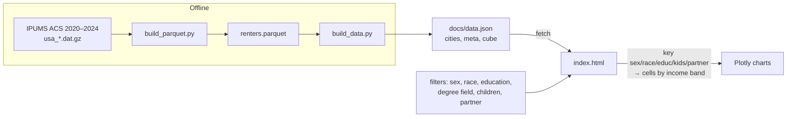

# How Rent Burden: Renters 23–35 is built

Two halves. An offline **Python pipeline** turns a raw IPUMS ACS extract into one precomputed JSON "cube" of
statistics. A **static dashboard** (one HTML page with Plotly) loads that file and charts it. No server: GitHub
Pages publishes `docs/`. The project is in progress: the statistics are not yet checked against published figures.

## Runtime

| Piece | What it uses |
|---|---|
| Charts | **Plotly.js** 2.32.0 (from cdn.plot.ly): four main line charts and small sparklines, redrawn with `Plotly.react` |
| Data | `docs/data.json` (12 MB): every combination of filters precomputed, fetched once |
| Libraries | Plotly only |

Pipeline (offline): Python with pandas, numpy and pyarrow. Tests: pytest (pipeline), Playwright + axe-core
(browser and accessibility).

## Files

```
build_parquet.py    raw IPUMS fixed-width extract (.dat.gz) -> renters.parquet: two passes, first per household
                    (size, whether anyone is a partner), then the target renters aged 23–35
build_data.py       renters.parquet -> docs/data.json: labels, the cube of cells, metadata
docs/index.html     the dashboard: filters, four charts, city sparklines (~350 lines, all inline)
docs/data.json      the cube
test_pipeline.py    pytest: weighted median, label mappings; data tests skip when the extract isn't present (CI)
e2e/                Playwright: smoke, axe
```

## How it fits together



## Core techniques

- **Reading the extract.** Fixed-width columns by position (the IPUMS layout), read in two passes so each person
  gets household facts (everyone in the unit, partner present) before filtering to renters 23–35 with rent and
  income above zero.
- **A precomputed cube.** For every combination of sex × race × education × children × partner status (and city),
  `build_cube` computes a cell per income band and overall; combinations with too few rows or too little
  weighted population are dropped. The dashboard only looks cells up; it computes nothing.
- **Per cell:** weighted median gross rent, median rent per person (rent ÷ household size), median burden,
  share severely burdened (rent > 50% of income), mean household size, with 95% intervals.
- **Intervals.** Kish effective sample size (n_eff = (Σw)² / Σw²) with a normal approximation; for medians,
  1.2533 × sd / √n_eff. Simple, but not the Census replicate-weight method (see limits).
- **Accessible colors.** Each series has a chart color and a darker text color with 4.5:1 contrast for labels.

## Testing and deploy

- `pytest test_pipeline.py`: the weighted median, education and degree-field label mappings, and (locally, with
  the extract) data checks: ages, marital codes, positive rents and incomes, education shares.
- `npx playwright test`: the dashboard at desktop and phone size, with axe accessibility checks.
- Pushing to `main` runs both in GitHub Actions (the shared workflow in
  [csciuto/app-template](https://github.com/csciuto/app-template)); only if they pass is `docs/` stamped with a
  version and published to GitHub Pages.

## Known limits

- Not checked against published rent-burden figures yet.
- Confidence intervals use a normal approximation on Kish's effective sample size, not the ACS replicate weights
  (the American Income Explorer uses replicate weights; that method would be the upgrade).
- The 12 MB data file loads slowly on phones; most cells could be split out and fetched on demand.
- The pipeline needs the raw extract, so CI can't rebuild the data; the generated file is committed.
